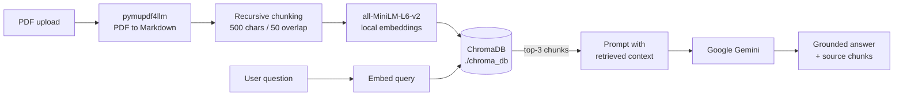

# 🤖 My RAG Bot: Vector-Backed Document Q&A


A Retrieval-Augmented Generation (RAG) web app that answers questions about your PDFs. Upload a document, ask a question, and get an answer grounded in the most relevant passages, with the retrieved context shown so you can verify it.

Retrieval runs **locally** (embeddings and vector database); answer generation uses the **Google Gemini API**.

> Unlike naive context-stuffing apps that paste the whole document into the prompt, My RAG Bot splits the document into chunks, embeds them, indexes them in ChromaDB, and sends Gemini only the top-k chunks that match the question.

---

## ✨ Features

- **Persistent vector store:** chunks and embeddings are saved in ChromaDB (`./chroma_db`), so indexes survive restarts.
- **Layout-aware PDF parsing:** `pymupdf4llm` converts PDFs to structured Markdown, keeping headings and tables intact.
- **Structure-aware chunking:** `RecursiveCharacterTextSplitter` (500 characters, 50 overlap) splits on paragraph and line boundaries before falling back to smaller separators.
- **Local embeddings:** `all-MiniLM-L6-v2` via `sentence-transformers`; no embedding API calls or costs.
- **Grounded answers:** Gemini is instructed to answer strictly from the retrieved context.
- **Transparent retrieval:** collapsible panels show the exact chunks used for each answer.
- **Dynamic model resolution:** active Gemini models are discovered with `genai.list_models()`, avoiding endpoint and version conflicts.

---

## 🏗️ Architecture



1. **PDF processing:** the uploaded PDF is converted to structured Markdown with `pymupdf4llm`.
2. **Chunking:** the text is split into overlapping chunks.
3. **Embedding:** each chunk is converted to a vector locally.
4. **Indexing:** chunks and metadata are stored in persistent ChromaDB.
5. **Retrieval:** the question is embedded and the 3 most similar chunks are retrieved.
6. **Generation:** Gemini answers using only the retrieved context.

---

## 🧰 Tech Stack

| Layer | Technology |
|---|---|
| UI | Streamlit |
| PDF parsing | PyMuPDF4LLM |
| Chunking | LangChain Text Splitters |
| Embeddings | Sentence-Transformers (`all-MiniLM-L6-v2`) |
| Vector database | ChromaDB |
| LLM | Google Gemini (`google-generativeai`) |
| Config | python-dotenv |

---

## 📂 Project Structure

```text
my_rag_bot/
├── backend/
│   └── rag_pipeline.py   # Chunking, local embeddings, ChromaDB retrieval
├── uploaded_files/       # Temporary PDF staging (git-ignored)
├── chroma_db/            # Persistent vector database (git-ignored)
├── app.py                # Streamlit frontend and augmented generation
├── requirements.txt      # Python dependencies
├── .env.example          # Template for environment variables
├── .gitignore            # Ignores database files, .env and virtualenvs
└── README.md
```

---

## 🚀 Getting Started

### Prerequisites

- Python 3.10 or higher
- Git
- A free Gemini API key from [Google AI Studio](https://aistudio.google.com)

### 1. Clone the repository

```bash
git clone https://github.com/pocharamjayanth/my_rag_bot.git
cd my_rag_bot
```

### 2. Create and activate a virtual environment

**Windows (PowerShell)**

```powershell
python -m venv venv
.\venv\Scripts\Activate.ps1
```

**Linux / macOS**

```bash
python3 -m venv venv
source venv/bin/activate
```

### 3. Install dependencies

```bash
pip install -r requirements.txt
```

The first run downloads the embedding model (about 90 MB), so it needs an internet connection once.

### 4. Configure your API key

Create a `.env` file in the project root:

```env
GEMINI_API_KEY=your_gemini_api_key_here
```

Alternatively, paste the key into the password field in the Streamlit sidebar. Never commit your `.env` file.

### 5. Run the app

```bash
python -m streamlit run app.py --server.address=127.0.0.1
```

Open <http://127.0.0.1:8501> in your browser.

---

## 💬 Usage

1. Upload a PDF in the sidebar and wait for indexing to finish.
2. Type a question about the document.
3. Read the answer, then expand **Sources** to inspect the retrieved chunks.

---

## ⚠️ Limitations and Disclaimer

- **Not medical, legal or professional advice.** This is a document reference tool. Always verify answers against the source and consult a qualified professional.
- **Retrieval is local, generation is not.** The retrieved chunks and your question are sent to the Gemini API. Do not upload sensitive or patient-identifiable documents unless that is acceptable for your use case.
- **Text-based PDFs only.** Scanned PDFs need OCR, which is not included.
- **Answer quality depends on retrieval.** Questions that need information spread across many sections may be only partly answered with top-3 retrieval.

---

## 🗺️ Roadmap

- Source citations with page numbers
- Multi-document collections and metadata filtering
- Re-ranking and hybrid (keyword + vector) search
- Optional fully local LLM (for example, via Ollama)
- Automated tests for chunking and retrieval

---

## 👥 Contributors

| Name | Contribution |
|---|---|
| **Jayanth** | Core RAG pipeline, vector indexing (ChromaDB), Gemini integration |
| **Krishna** | Data extraction (PyMuPDF4LLM) and document preprocessing |
| **Gargeya** | UI/UX design and Streamlit application logic |
| **Srujan** | System testing, environment configuration and optimization |

---

## 📝 License

This project is released under the [MIT License](LICENSE).
